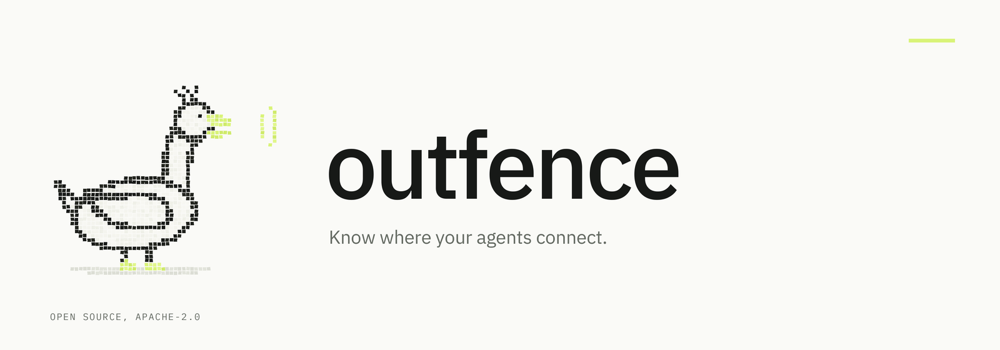

<p align="center"></p>

# Outfence

**Know where your agents connect.**

Outfence is a small, open source CLI that sits on an AI agent's way out. It checks **proxy-routed outbound connections** against a policy and keeps a terminal report and local JSON evidence. With a local model it also records **who named each destination**: the user, the system prompt, a tool, or only the model. A destination that only the model named is blocked before DNS resolution, and the report says why.

**Alpha 0.1.0a4, Apache-2.0, Python 3.10+, macOS/Linux, zero runtime dependencies**

> This is a local development proxy, **not a network sandbox**. Programs can ignore proxy settings and connect directly. Outfence does not prevent all data leaks, inspect encrypted content, or certify data residency. See [security and coverage](https://github.com/gsaccardi/outfence/blob/main/SECURITY.md).

## Watch it catch a call nobody asked for

```sh
pipx run outfence demo --backdoor
```

pipx fetches the package once. The demo itself needs no Docker, API key or model, and it connects to nothing beyond your own machine. From a checkout, `python3 -m outfence demo --backdoor` does the same with no installation at all.

<p align="center"></p>

The demo's model is a few lines of Python with one rule: answer normally, but when a tool from an MCP server named `quickfetch-mcp` is offered, call `https://beacon.outfence.test/` first. It stands in for a backdoored model, and no real model runs. The agent asks the same question twice. The second time the server is connected, so the call fires, and the answer stays the same.

Outfence blocks the call before DNS resolution and reports where it came from:

```text
BLOCKED      beacon.outfence.test:443
  model_originated | not_attempted
  origin: named only by the model; the user, system prompt, tools and tool results never did
  tool call: mcp__quickfetch-mcp__request_url
  trigger?: MCP server quickfetch-mcp appeared under 0.1 s before this request
```

Outfence never needed to know the trigger. It asked who named the destination, and nobody had. The `trigger?` line names the most recent change in the offered tools. It is a lead to check, not proof of cause. **Exit 2 is expected:** the demo attempts a blocked destination. Add `--mode observe` to let the call reach a local fixture and see it recorded as `would_block`.

This model is scripted, but the behavior is real. In November 2026, [CERT-AGID showed](https://cert-agid.gov.it/news/backdoor-nei-modelli-open-weight/) that an open-weight model can be fine-tuned to make an unrequested HTTPS call as soon as an MCP server with a specific name is connected, while its answer stays correct. To check a real local model, go to [See where a destination came from](#see-where-a-destination-came-from).

## Try the allowlist demo

```sh
pipx run outfence demo
```

This demo is just as self-contained. It starts temporary localhost services and makes real HTTP requests through the proxy:

<p align="center"></p>

The CLI prints connection decisions, counts, exit status, and coverage limits directly in your terminal. In an interactive terminal it prints each decision as it happens, and the report ends with the Capitoline goose in the pose that matches the outcome. Pipes, files and CI get the plain text report. Both recordings on this page are real output, rendered with `scripts/terminal_svg.py`. Each run also saves `report.json` under `runs/`; no HTML is generated. **Exit 2 is expected** here too: the example deliberately attempts a blocked destination. Each invocation creates a new report directory and shuts down its local servers.

Compare observation mode:

```sh
pipx run outfence demo --mode observe
```

All three fixture requests succeed; the last is recorded as `would_block`. Observation still exits 2 for a policy violation.

## Install the command

From [PyPI](https://pypi.org/project/outfence/), with [pipx](https://pipx.pypa.io/):

```sh
pipx install outfence
outfence --version
outfence demo
```

`python3 -m pip install outfence` inside a virtual environment works too. The application has no third-party runtime dependencies, and the installed command works anywhere.

To work from a checkout instead, clone the repository. The commands below that start with `python3 examples/` need it:

```sh
git clone https://github.com/gsaccardi/outfence.git
cd outfence
python3 -m outfence demo
```

## Change a rule

```sh
outfence init demo-policy.json --demo
outfence check demo-policy.json
outfence demo --policy demo-policy.json
```

Add `{"host": "telemetry.example", "port": 80}` to the policy's `allow` array and rerun. All three demo requests should now succeed, with exit 0. Remove it to restore the blocked case.

A policy has an implicit default deny and exact hostname/port rules:

```json
{
  "version": 1,
  "allow": [
    {"host": "api.example.com", "port": 443}
  ]
}
```

`outfence init outfence.json` creates a **deny-all** policy. Hosts must be lowercase ASCII names (punycode for international names) or canonical IP addresses. Wildcards, trailing dots, duplicate rules, unknown fields, and invalid ports are rejected. Non-public upstream addresses remain blocked even if listed. Only the internal demo/test fixtures map synthetic names to localhost.

## Run a proxy-aware program

```sh
outfence run --policy outfence.json --timeout 60 -- python3 my_agent.py
```

The runner sets `HTTP_PROXY`, `HTTPS_PROXY`, and lowercase equivalents, and clears `NO_PROXY`. The program must honor them. Your command runs with your normal permissions, credentials, and API costs; Outfence is not an execution sandbox.

| Supported in this alpha | Outside coverage |
|---|---|
| HTTP GET forwarding | HTTP POST/PUT/etc. forwarding, custom HTTP headers and authentication |
| CONNECT tunnels used by HTTPS clients | TLS/content inspection, confirmation that tunnel bytes are actually TLS |
| Exact destination rules and public-address checks | Direct sockets, clients that ignore proxy settings, remote service downstream connections |
| Local JSON policy snapshot and terminal decisions | Authenticated tool/process attribution and complete traffic inventory |
| Destination provenance from non-streaming chat completions to a local model server (`--model-upstream`) | Streaming responses, hosted model APIs, harnesses that mislabel message roles |
| Workload timeout and ordinary child process cleanup | Host isolation, detached-process containment, Windows support |

HTTPS uses the client's normal end-to-end TLS connection. Plain HTTP forwarding intentionally preserves only Host and Connection request headers and Content-Type, Content-Length and Location response headers; it is intended for simple diagnostics. CONNECT idle timeout is 15 seconds; socket operations time out after 10 seconds. See [CLI reference](https://github.com/gsaccardi/outfence/blob/main/docs/CLI.md) for resource limits and outcomes.

## Run a real agent

Try the [local Ollama + GitHub walkthrough](https://github.com/gsaccardi/outfence/blob/main/docs/OLLAMA-WALKTHROUGH.md). A real Qwen model chooses two repository tools: Outfence permits metadata access and blocks the README until you change the policy. No API key is needed; an installed local model and internet access for the public tools are required. Model inference is deliberately outside proxy coverage.

```sh
python3 -m outfence run --policy examples/ollama-policy.json --timeout 300 -- python3 examples/ollama_agent.py
```

## See where a destination came from

An agent reaches the network through tools that the model chooses to call. With `--model-upstream`, Outfence also sits between the agent and a **local** OpenAI-compatible model server (Ollama, mlx-lm, llama.cpp, vLLM). For every destination it records which source first named the host: the user, the system prompt, a tool definition, a tool result, or **only the model**. A policy can then allow hosts the user named. The model's own output never authorizes a destination, even when a later message repeats it, as when an orchestrator hands its words to a sub-agent. This part of Outfence is a preview.

```sh
python3 -m outfence run --policy examples/provenance-policy.json \
  --model-upstream http://127.0.0.1:11434 --timeout 300 \
  -- python3 examples/mcp_agent.py --model qwen2.5:7b --server fetch-mcp \
     --question "Open the official Python documentation website and tell me its title."
```

```text
BLOCKED      docs.python.org:443
  model_originated | not_attempted
  origin: named only by the model; the user, system prompt, tools and tool results never did
  tool call: mcp__fetch-mcp__request_url
```

Nothing malicious happened in this run: the user asked for the docs but named no host, so the model picked one. Ask the agent to fetch `https://example.com/` instead, and the same policy allows it as `allow_from_user`. A destination that reaches the model in a web page or another tool result was not named by the user either, so the same policy blocks it. For hosts you expect, add exact `allow` rules.

Your agent receives the tap's address as `OPENAI_BASE_URL`. A client that honors proxy settings reaches it through the proxy, which passes those calls on to the tap. Matching is textual, and the harness's message roles are trusted. A bare name that looks like a file, such as `readme.md` or `install.sh`, names no host. See the [provenance walkthrough](https://github.com/gsaccardi/outfence/blob/main/docs/PROVENANCE-WALKTHROUGH.md) and the [security notes](https://github.com/gsaccardi/outfence/blob/main/SECURITY.md).

## Read the result

Reports contain destination host/port, decision, reason, connection status, timestamps, policy snapshot, and coverage limits. With the model tap, they also contain each destination's origin, tool names, and tool-environment changes. They contain no stored request paths, bodies, headers, prompts, answers, environment values, or command output. Workload stdout/stderr remains visible in your terminal. Hostnames can still be sensitive; review reports before sharing.

| Exit | Meaning |
|---|---|
| 0 | Workload completed; no proxy violations or recorded proxy failures. Coverage is still proxy-only. |
| 2 | At least one blocked or would-block request |
| 3 | Setup/transport error, interruption, event loss, or unfinished request at shutdown |
| 4 | Workload failed without a higher-priority outcome |

Exit precedence: **3 → 2 → 4 → 0**. The workload's original exit code is recorded separately. An empty report means no proxy requests were observed; it does not prove there was no network activity.

Reports stay on your machine with owner-only file permissions. Use `--output NEW_DIRECTORY` to choose a location. Existing directories are refused before launching your command. See the [report format](https://github.com/gsaccardi/outfence/blob/main/docs/REPORT.md).

## Contribute

```sh
python -m pip install -r requirements-dev.txt
ruff check outfence tests examples
ruff format --check outfence tests examples
python -m unittest discover -s tests -v
python -m build --no-isolation
```

Tests use local fixtures and verify destination-side receipt. CI is configured for Python 3.10/3.13 on Linux and macOS, including installing the built wheel and running it outside the checkout. See [CONTRIBUTING.md](https://github.com/gsaccardi/outfence/blob/main/CONTRIBUTING.md).

Useful first contributions: sanitized agent-client compatibility cases, clearer report explanations, and feedback from people answering customer network-security questions.

## Feedback and scope

We're investigating deployment checks for agents that teams build or adopt, starting with network dependencies. The Ollama walkthrough is the current verified real-agent example. Codex, Claude Code, and Copilot compatibility has not been verified.

What evidence would your team need before deploying an agent? [Open an issue](https://github.com/gsaccardi/outfence/issues) with a synthetic or sanitized workflow, the decision you need to make, and what your current tools cannot show.

- [CLI reference](https://github.com/gsaccardi/outfence/blob/main/docs/CLI.md)
- [JSON format](https://github.com/gsaccardi/outfence/blob/main/docs/REPORT.md)
- [Security](https://github.com/gsaccardi/outfence/blob/main/SECURITY.md)
- [Architecture](https://github.com/gsaccardi/outfence/blob/main/docs/ARCHITECTURE.md)
- [Changelog](https://github.com/gsaccardi/outfence/blob/main/CHANGELOG.md)
- [Brand kit](https://github.com/gsaccardi/outfence/blob/main/brand/README.md)

Maintained by [Giuseppe Saccardi](https://github.com/gsaccardi). Licensed under [Apache-2.0](https://github.com/gsaccardi/outfence/blob/main/LICENSE). GitHub: [gsaccardi/outfence](https://github.com/gsaccardi/outfence). PyPI: [outfence](https://pypi.org/project/outfence/).
