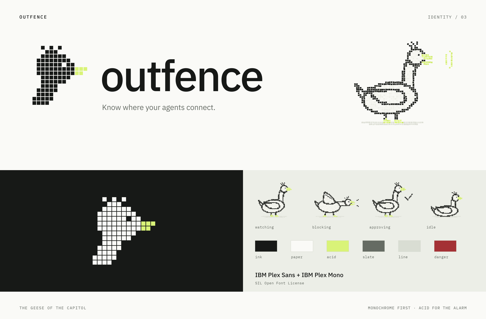

# Outfence brand guide

**Identity 03 · 5 November 2026**



## Name and positioning

**Outfence** combines outbound activity with a boundary. Pronounce it "OUT-fens." Write Outfence in prose and `outfence` for the repository and CLI. The wordmark is lowercase on purpose.

Primary line: **Know where your agents connect.**

Supporting line: **Local policies. Reviewable evidence.**

One sentence: "Outfence helps developers inspect proxy-routed agent connections and apply local destination policies."

## The goose

In 390 BC the Gauls climbed the Capitol at night. The guard dogs stayed silent, but the geese sacred to Juno raised the alarm and Rome held. Outfence's mark is that goose: a white Capitoline goose with a Roman Tufted crest and an acid beak, built from mosaic tiles.

The mark is the goose's head on a 14-tile grid:

- Tiles are aligned and evenly spaced, with a 16% gap. Never nudge, rotate or recolor individual tiles in the mark.
- Minimum size is 16 px for favicons and 24 px in interfaces. Keep clear space of at least two tiles on every side.
- Use the ink mark on light backgrounds and the white mark on dark ones. The beak stays acid. Where color is unavailable, the beak takes the mark color; the crest and eye still identify the goose.
- Do not add outlines, shadows, gradients, glows or a containing shape, except on the square avatar.

## Mosaic illustrations

Illustrations show the whole goose as a mosaic. Their tiles vary slightly in tone and turn up to 5 degrees, as if laid by hand. The variation is seeded, so every export is identical. Each pose matches a CLI outcome:

| Pose | Outcome |
|---|---|
| Watching | Run in progress |
| Alarm | A destination would be blocked (observe mode) |
| Blocking | A destination was blocked (enforce mode) |
| Approving | Allowed |
| Idle | No proxy traffic |

Tile art lives in [mascot.json](mascot.json) as run-length-encoded rows: `k` ink, `w` white, `a` acid, `s` shadow, `.` empty. Edit it like pixel art, then rebuild. On dark backgrounds, outlines turn dark grey and the white body carries the shape.

## Palette

| Token | Hex | Use |
|---|---|---|
| Ink | `#171917` | Primary text, outlines and dark backgrounds |
| Acid | `#D9F378` | The alarm: beak, feet and alarm waves. Never required to recognize the logo |
| Paper | `#FAFAF7` | Light canvas, text on ink and the goose's body |
| Slate | `#656B63` | Secondary text on paper |
| Mist | `#C2C6BC` | Secondary text on ink |
| Line | `#D9DDD3` | Dividers and decorative boundaries |
| Success | `#17664D` | Allowed/passed label on paper |
| Warning | `#865500` | Observation or incomplete coverage label on paper |
| Danger | `#A43135` | Blocked/error label on paper |

Use ink text on acid. Acid is unsuitable for small text on paper. Pair every state color with a word, a symbol or a goose pose; never communicate a policy decision through color alone. The line color is decorative and must not be the only indicator of an interactive control.

## Typography

The wordmark and headings use **IBM Plex Sans** (Medium for the wordmark, Regular for text). Labels, code and terminal output use **IBM Plex Mono**. Both are free under the SIL Open Font License. This repository does not distribute the font files. The build outlines all SVG text, so the SVGs look the same on systems without Plex.

Web fallback stacks: `'IBM Plex Sans', Arial, Helvetica, sans-serif` and `'IBM Plex Mono', 'Courier New', monospace`. Use a 4 px spacing base, generous margins, short headings and clear labels. Keep surfaces flat, with generous whitespace and one clear visual hierarchy.

## Voice

Precise, calm, useful. Name the observed action and its scope.

Use: "Blocked telemetry.example:443 because it is outside your allowlist."

Use: "Coverage incomplete: the collector stopped before the workload exited."

Avoid "leak-proof," "sovereignty certified," "complete visibility" or "production-ready" without supporting evidence. Do not substitute investor language for a concrete developer job.

## Assets

| Asset | Vector | Raster | Intended use |
|---|---|---|---|
| Ink mark | [SVG](assets/mark-ink.svg) | [PNG](assets/mark-ink.png) | Transparent icon on light backgrounds |
| White mark | [SVG](assets/mark-white.svg) | [PNG](assets/mark-white.png) | Transparent icon on dark backgrounds |
| Avatar | [SVG](assets/avatar.svg) | [PNG](assets/avatar.png) | 512 × 512 GitHub avatar |
| Light wordmark | [SVG](assets/wordmark-light.svg) | [PNG](assets/wordmark-light.png) | 760 × 180 transparent lockup |
| Dark wordmark | [SVG](assets/wordmark-dark.svg) | [PNG](assets/wordmark-dark.png) | 760 × 180 dark lockup |
| README banner | [SVG](assets/banner.svg) | [PNG](assets/banner.png) | 1600 × 560 banner |
| Social preview | [SVG](assets/social-preview.svg) | [PNG](assets/social-preview.png) | 1280 × 640 social card |
| Brand board | [SVG](assets/brand-board.svg) | [PNG](assets/brand-board.png) | 1600 × 1050 identity overview |
| Goose poses | [watching](assets/goose-watching.svg) · [alarm](assets/goose-alarm.svg) · [blocking](assets/goose-blocking.svg) · [approving](assets/goose-approving.svg) · [idle](assets/goose-idle.svg) | PNG alongside each | 400 × 320 transparent illustrations |

Machine-readable colors, typography and tile settings: [tokens.json](tokens.json). To rebuild the artwork, install Pillow and fontTools, download the four IBM Plex TTFs (Sans and Mono, each in Regular and Medium), and run this from the repository root:

```sh
OUTFENCE_FONT_DIR=/path/to/plex python3 scripts/build_brand.py
```

The repository and artwork use Apache-2.0, and the brand name remains provisional. The repository is github.com/gsaccardi/outfence. No trademark, domain or package-registry name has been reserved.
